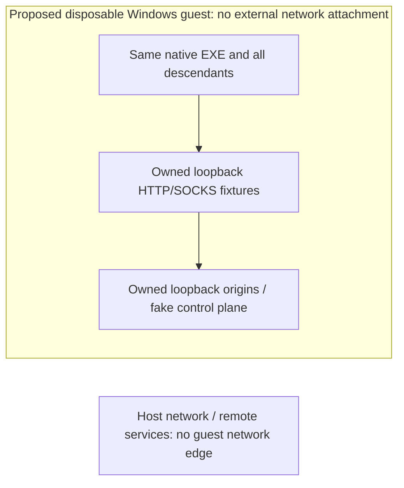

# Windows native egress boundary — PARTIAL / no installation GO

Two different boundaries are necessary: **air-gapped native offline lab first**;
**process-scoped broker-only egress later**. Neither exists as a demonstrated
boundary in this TASK. No VM/feature/driver/filter/session/security token created.

## A. Preferred first native lab: disposable Windows VM

Same hashed Windows EXE and offline fixtures inside a pre-authorized disposable
Windows VM. No external virtual NIC, NAT, bridge, default gateway, DNS service,
host proxy/port forwarding, host sockets/pipe relay, clipboard/file-trigger bridge
or other network-capable guest integration channel. Stage offline bytes, hash
inside, then remove staging/integration channels before execution. Do not run a
live V2Ray on host loopback and call that an isolated guest fixture.

Attestation before USER GO: hypervisor identity/config export with no network
attachments and no side-channel forwarding; guest inventory only loopback and no
external routes; offline dependency/binary manifest; no credentials; exact guest
image/snapshot; independently reviewed scope and read-only proof retention.
Guest inventory alone is not an enforceable boundary. Trusted hypervisor/OS is
assumed; compromise of that trusted computing base is outside this bounded proof.
No native run is authorized merely by finding such a VM.

Future USER GO must name the VM/snapshot, EXE hash, synthetic endpoints, cases,
duration/cleanup and independent isolation-verifier evidence. All network faults
remain on owned loopback. No public IP/DNS/OpenAI/Cloudflare canary, even as an
intentional bypass. Product fallback attempted inside the guest is a product
failure regardless of whether the external air gap would have stopped it.

## B. Future operational process-scoped boundary (WFP candidate)

Local SDK 10.0.19041.0 declarations verified by hash/selectors in
`windows_source_evidence.json`: ALE_AUTH_CONNECT v4/v6, App ID/user/package
conditions, remote address/port/protocol conditions, block action, transactions,
filter add/delete and net-event APIs. **No WFP API was invoked.** Header presence
does not prove installed policy, loopback handling, priority/arbitration,
descendant inheritance, persistent/boot/crash behavior or existing-flow closure.

Required architecture, not an implemented installer:

1. An authenticated scope covers the runtime root, CONNECT adapter, WUA STDIO/API
   components and **all** descendants, independent of executable filename. Unknown
   child is contained before any user code/network opportunity; no create-then-
   asynchronously-add-rules race. PID must include a creation generation; PID/path
   alone is not identity. Shared Python EXE must not affect unrelated applications.
2. Default deny every protocol/family/interface for members, including loopback,
   except exact intended **directed edges**: client→dedicated HTTP proxy,
   adapter→dedicated SOCKS proxy, approved read-only child→its local API. No
   localhost:* allowance. UDP/DNS/DoH/DoT/IPv6/IPv4-mapped endpoints get no bypass.
3. Scope registration, denies and exact permits must be installed/read back before
   members resume. Filter precedence and conflicts with other providers require
   source/documentation plus contained runtime proof. App-path rules cannot be
   assumed to cover arbitrary child binaries or a process tree.
4. Prove target service identity, not only its port. Current listener ownership
   snapshot is not an atomic peer-binding guarantee: a broker can die and another
   process take its port. Need an explicitly reviewed receiver-identity/port lease
   or authenticated local broker design. Not solved by a generic SOCKS NO AUTH
   greeting or a PID check followed by connect. This is an OPEN implementation gap.
5. Broker's own remote route/DNS/DIRECT behavior is separately attested. The
   exception is only the approved broker→approved upstream, not any external
   connection from sing-box. Current shared V2Ray settings are outside write scope;
   no new blanket restriction/permit is applied to it or other Windows apps.
6. Unexpected child, route/identity lease loss, monitor failure or policy mismatch
   must deny new flows and terminate existing scoped connections/processes safely.
   Connect-time filtering alone must not be presumed to revoke established flows.
   Buffered/in-flight traffic and reauthorization need explicit acceptance tests.
7. Fail closed on controller/session/BFE failure: denial must not disappear while
   members still run. SDK exposes dynamic/persistent/boottime flags, but their
   semantics are not established here. Do not assume dynamic-session cleanup is
   safe rollback. `PERMIT_IF_CALLOUT_UNREGISTERED` is not an acceptable escape for
   a mandatory deny boundary. Any callout/driver approach needs separate design,
   signing/install authority and independent fail/crash/reboot tests.
8. Independent observer records flow **attempts** and process-birth events with
   authenticated scope/generation; loss/overflow trips the test. Content/credentials
   are excluded. OS verdict and observer independently cross-check; dropped
   flow count is not inferred from absence of origin traffic.

No exact enforceable descendant-identity backend has been implemented/proved.
`FWPM_SESSION0.processId` is session metadata, not evidence of a process-tree
filter. The standard App ID/package declarations do not by themselves solve
arbitrary child/IPC broker coverage. WFP branch is therefore **PARTIAL**, not GO.

## C. Rollback contract for a separately authorized future installer

There is nothing installed to roll back now. Future changes require a manifest
of exact task-owned provider/sublayer/filter/callout keys and previous **owned**
state, with no whole-Windows policy export/restore and no third-party deletion.

1. Freeze admissions and deny new flows; verify scope membership and active flows.
2. Stop/reap only owned root/descendants, close scoped connections; independently
   verify no live member can regain a route. If this fails, keep deny active and
   leave explicit recovery evidence. Never delete protection to make cleanup green.
3. Remove only exact owned objects in a verified transaction/order; restore only
   the recorded pre-install owned values. No firewall reset, global service stop,
   route/DNS/proxy change, unrelated process kill or historical config restore.
4. Read back absence/restored owned objects, unrelated state unchanged, no worker/
   handle leak. Partial failure has a durable recoverable journal, not retry-all.
5. For VM-only lab: after owned processes stop, destroy/revert only that disposable
   guest/snapshot through its approved host boundary; host V2Ray/firewall unchanged.

Exact executable rollback commands cannot safely be supplied for an unimplemented
backend. The ordering/ownership/error contract is specified; platform-specific
installer/rollback remains BLOCKED until selected and separately authorized.

## Current read-only observations and stop decision

Windows 10.0.19045; SDK headers present. Sandbox executable absent; bounded command
inventory/feature state does not identify a ready attested VM. BFE service presence
is not an active MCP deny policy. Source pack, OS boundary proof, independent
isolation review and separate native USER GO absent. **NATIVE EXECUTION BLOCKED**.
Python tests verify reference decisions only, never promote this design to
`OS-ENFORCED EGRESS ISOLATION VERIFIED`.
