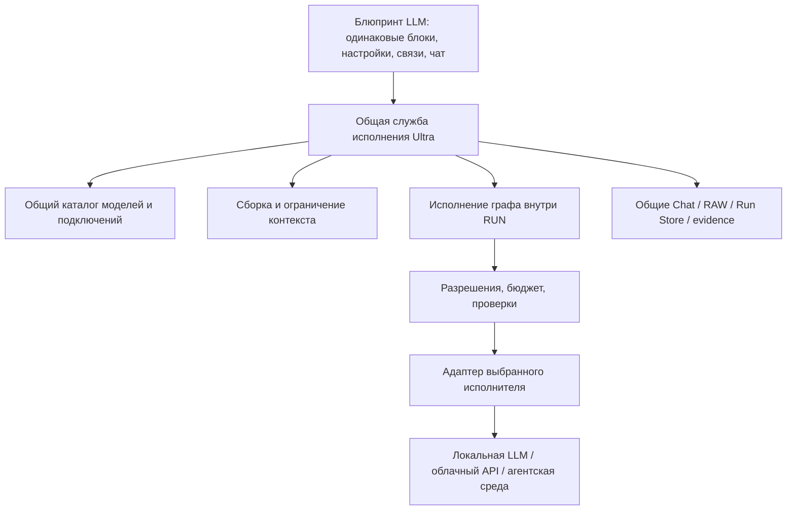

Да. **Блок должен только описывать, какую работу выполнить выбранной нейросетью, а Ultra — организовывать её выполнение.** Пользователь добавляет один и тот же универсальный LLM-блок, выбирает исполнителя, меняет роль, подключает входы и получает результат. Способ подключения модели остаётся внутри Ultra.

Это реализуемо на вашей базе. Но после чтения исходников я бы сформулировал задачу точнее: **существенная часть необходимых механизмов уже существует, однако общего интерфейса, через который произвольный экземпляр блока мог бы ими пользоваться, пока нет.** Именно его нужно сделать основой конструктора.

Я изучил приложенный запрос, профильные документы и текущий код. Ниже — архитектурное предложение. Исходники и документы не менял, модели не запускал; существующие тесты и отчёты использовал как материалы исследования, новой runtime-приёмки не проводил.

**Один универсальный блок — правильная основа.**

У него должен быть один программный тип, условно `llm`, и сколько угодно экземпляров в пределах ресурсов:

|Экземпляр|Выбранный исполнитель|Роль|
|---|---|---|
|Блок A|DeepSeek на первом компьютере|Планировщик|
|Блок B|Другая доступная модель|Исполнитель|
|Блок C|GigaChat через API|Проверяющий|

Во всех трёх случаях одинаковы устройство блока, правила подключения пинов и жизненный цикл. Различаются настройки.

Причём модель и роль должны выбираться независимо. Одна модель может работать в нескольких блоках с разными ролями, а один блок можно перенастроить на другую модель без перестройки схемы.

**Роль можно менять на лету в редакторе.** Для запуска нужны следующие правила:

- До запуска изменение применяется сразу.
- При запуске сервер фиксирует версию настроек всего графа.
- Если пользователь меняет роль во время выполнения, текущий RUN продолжает работать по своему снимку, а новый запуск использует обновлённую роль.
- Позже можно добавить управляемое применение изменений после остановки на контрольной точке.

Фиксировать весь граф нужно потому, что иначе один проход может незаметно начать работать по одной логике, а закончить по другой.

Роль здесь — назначение и набор настроек: инструкция, предпочтительный формат результата, правила контекста. **Название роли не выдаёт полномочий.** Выбор «программист» позволяет попросить модель написать код, но право записать его в проект предоставляет сервер отдельно.

---

**В существующем проекте есть хорошая основа, но несколько границ особенно важны.**

|Компонент|Что подтверждается текущим кодом|Как использовать для Blueprint|
|---|---|---|
|[model_registry.py (line 9)](M:/GitHub/ag_llm/model_registry.py:9)|Общий `ModelSpec`, шесть встроенных моделей GigaChat, проверка включённости. Многохостовой каталог здесь ещё не реализован.|Сохранить единственным логическим владельцем моделей; расширить привязками к подключениям.|
|[ultra_connections.py (line 67)](M:/GitHub/ag_llm/web_alarm/ultra_connections.py:67)|Каталог строится из общего реестра; сохраняется выбор для роли `chat`. Текущий ID — `api:provider:model_id`. Локальные модели и MCP в этом каталоге пока `NOT_CONNECTED`.|Переиспользовать представление каталога и выбор по ссылке. Добавить самостоятельную идентичность подключения.|
|[model_cards.py (line 280)](M:/GitHub/ag_llm/web_alarm/model_cards.py:280)|Профили, карточки, диагностические статусы, контракт проверяющего. Имитация не считается подтверждением настоящего API.|Использовать для настроек и отображения доступности. Карточка провайдера сама по себе адаптером не становится.|
|[server.py (line 3696)](M:/GitHub/ag_llm/server.py:3696)|Рабочий агентский запуск, инструменты, разрешения, события и проверки. Основной исполнитель явно отказывает провайдеру, отличному от GigaChat.|Выделить общий интерфейс вызова модели, сохранив действующие проверки. Прямой вызов всего `run_agent_task()` для каждого простого блока не подходит.|
|[context_storage.py (line 719)](M:/GitHub/ag_llm/context_storage.py:719) и [context_registry.py (line 447)](M:/GitHub/ag_llm/context_registry.py:447)|Workspace/Chat, RAW, идемпотентная запись сообщения, варианты контекста, библиотека инструкций.|Переиспользовать хранение и инструкции. Добавить контракт адресного контекста конкретного вызова блока.|
|[task_planner.py (line 206)](M:/GitHub/ag_llm/task_planner.py:206), [verifier_runtime.py (line 392)](M:/GitHub/ag_llm/verifier_runtime.py:392)|Последовательный TaskLifecycle, структурированные планы, evidence-проверки, отдельный verifier. Универсального исполнения произвольного графа нет.|Сохранить действующий стандартный процесс и переиспользовать его проверяющие механизмы через общие интерфейсы.|
|[run_store.py (line 78)](M:/GitHub/ag_llm/run_store.py:78), [audit_storage.py (line 240)](M:/GitHub/ag_llm/audit_storage.py:240)|RUN, индекс, события, контрольные суммы, аудит. В текущем коде уже присутствует исправление блокировки P9.|Добавить идентичность вызова блока и обобщить учёт ролей. Запись событий одного RUN должна оставаться согласованной.|
|[provider_accounting.py (line 85)](M:/GitHub/ag_llm/provider_accounting.py:85), [ultra_budget_policy.py (line 631)](M:/GitHub/ag_llm/ultra_budget_policy.py:631)|Идентификаторы физических попыток, сведения о запросах, функции резервирования и учёта неопределённых исходов.|Использовать для каждого вызова, включая проверяющие модели и повторные попытки. Полное подключение нового пути к бюджетному контуру ещё требуется.|
|[Ultra Chat (line 120)](M:/GitHub/ag_llm/web_alarm/ultra_chat.py:120), [его интерфейс (line 305)](M:/GitHub/ag_llm/web_alarm/ui.py:305)|Чтение истории, создание и переименование чатов. Отправка сообщения в UI отключена; общего рабочего Turn-пути отправки здесь пока нет.|Нижний чат Blueprint строить поверх продолжающейся миграции Ultra Chat.|
|[Web Alarm Closeout](M:/GitHub/ag_llm/web_alarm/closeout.py) и [Operation Contract](M:/GitHub/ag_llm/web_alarm/operation_contract.py)|Отдельные серверные механизмы TASK, операций, доказательств и завершения.|Использовать для действий с проектом; граф не должен присваивать себе их полномочия.|

Есть существенное уточнение к оперативной сводке: **P9 уже реализован в локальном коде, но его независимая приёмка ещё ожидается.** Хеши `run_store.py` и соответствующего теста совпали с манифестом [пакета P9](M:/GitHub/ag_llm/reports/CLAUDE-WUA-CHAT-RUNSTORE-P9-001/report.md). Поэтому корректный статус — «реализовано, ожидает независимой проверки».

И ещё: эта доработка защищает общий индекс Workspace. Она не превращает запись событий одного RUN в многописательную систему. Для параллельных блоков нужен **один серверный писатель событий RUN**, принимающий результаты всех ветвей.

Сам Blueprint, общий исполнитель графа и универсальный многохостовой вызов пока относятся к новой разработке. Автоматический «Круглый стол» также нельзя считать реализованным на основании существующего документального протокола.

---

**Рекомендуемая архитектура — небольшой модульный слой внутри общего Python-ядра.**

Схема ниже — предлагаемое устройство:

````

````

Блок передаёт ядру примерно такое поручение:

> «Вызови выбранного исполнителя с этой ролью, этими входами и разрешённым контекстом. Ожидаемый результат соответствует такому контракту».

Он не знает IP-адреса, способа авторизации, формата HTTP-запроса или устройства очереди.

У общего ядра остаются:

- разрешение выбранного исполнителя;
- сборка контекста;
- проверка возможностей и полномочий;
- запуск и учёт попыток;
- выполнение разрешённых инструментов;
- проверка результатов;
- сохранение состояния и восстановление;
- принятие окончательного решения.

**Исполнитель графа действительно понадобится.** В текущем TaskLifecycle произвольного графа нет. Но его следует сделать способом исполнения общего RUN, с теми же хранилищами и полномочиями.

Стандартный процесс Ultra и Blueprint могут иметь разные стратегии выполнения. Необязательно сразу переписывать стандартный процесс в граф. Важно, чтобы они пользовались общими службами и не управляли одним RUN одновременно.

Также следует различать **ядро Ultra** и **модель GigaChat Ultra**. В выборе модели может присутствовать GigaChat Ultra. Всё ядро Ultra не является одной моделью. Сохранённый сложный процесс впоследствии можно представить составным блоком.

Из двух архитектурных вариантов я рекомендую второй:

|Критерий|A. Тонкая оболочка над нынешними функциями|B. Общие интерфейсы внутри существующего ядра|
|---|---|---|
|Начальный объём|Меньше|Умеренный: выделение вызова, контекста и исполнения графа|
|Повторное использование|Высокое, но сильная зависимость от нынешних сигнатур|Высокое, с явными границами|
|Несколько серверов|Быстро обрастает исключениями|Поддерживаются через подключения и адаптеры|
|Переносимость|Зависит от каждого места вызова|Ссылки отделены от машинных настроек|
|Расширение графа|Сложнее добавлять повтор, ветви и вложенность|Предусмотрено контрактом вызова|
|Риск дублирования|Высок при копировании логики в веб-слой|Ниже при сохранении владельцев данных|
|Влияние на миграцию чата|Сначала небольшое, затем возможны переделки|Согласуется с общим Turn-путём сразу|
|Главная точка отказа|Разные ветки начинают выполнять разные проверки|Ошибка общего слоя влияет на оба режима, поэтому нужны регрессионные проверки|

Для варианта B не нужны отдельные микросервисы, брокер сообщений или новый сервер подключений. Первоначально это обычные Python-модули.

---

**Выбор LLM следует организовать через общий каталог доступных исполнителей.**

Пользователь должен видеть одну понятную строку выбора:

> `DeepSeek R1 · Домашний ПК №1 · Ollama`

Под ней Ultra различает несколько сущностей:

|Сущность|Что означает|
|---|---|
|Компьютер / ресурсная группа|Где находятся вычислительные ресурсы. Несколько API могут использовать одну GPU.|
|Подключение|Конкретный настроенный способ обращения: протокол, авторизация, локальная привязка адреса.|
|Модель|Идентификатор модели и известные свойства.|
|Доступный исполнитель|Проверенная привязка модели к подключению либо поддерживаемой агентской среде.|

В блоке достаточно хранить `target_ref` — ссылку на выбранного исполнителя. Это представление над общим каталогом, а не ещё один независимый реестр.

Одинаковая модель на двух компьютерах даёт два варианта выбора. Изменение IP не должно менять идентичность самого блока или переписывать историю.

Текущий `api:provider:model_id` не различает две установки одной модели у одного провайдера. Для него нужна явная совместимая миграция ссылок, а не простое добавление ещё одного сегмента.

Компоненты можно распределить без лишнего дробления:

- **Connection Manager** — функции общего каталога: профили, привязки, состояния.
- **Provider Discovery** — методы адаптеров `health` и `list_models`, с общим кешем.
- **Provider Adapter** — отдельная необходимая граница перевода протокола.
- **Model Router** — сначала обычное разрешение выбранного `target_ref`. Автоматический подбор и переключение моделей можно отложить.

Доступность нужно хранить как несколько независимых фактов:

`настроено → сервер отвечает → нужный API поддерживается → модель найдена → inference проверен`

Это не обязательно линейная лестница. Например, модель может быть установлена, но не загружена в память. У Ollama для списка моделей и моделей в памяти существуют разные методы: [`/api/tags`](https://docs.ollama.com/api/tags) и [`/api/ps`](https://docs.ollama.com/api/ps).

Каждый факт должен содержать время наблюдения, срок актуальности, версию настроек и ссылку на доказательство. Отдельно хранится разрешение выполнить вызов. Успешная проверка вчера не гарантирует ответ сегодня.

Для первого локального подключения логичнее опереться на уже исследованный путь Ollama. **Colibri остаётся `NOT VERIFIED` в части фактического поддерживаемого вызова из Ultra** до адресной проверки; переносить на него предполагаемую совместимость нельзя.

---

**Общий вход блока должен быть внутренним контрактом Ultra.**

Я предлагаю следующий минимальный контракт вызова:

|Поле|Назначение|
|---|---|
|`invocation_id`|Конкретный вызов экземпляра блока|
|`node_id`, `run_id`|Его принадлежность графу и запуску|
|`target_snapshot`|Зафиксированный исполнитель и версии подключения|
|`role_snapshot`|Выбранная роль и инструкция|
|`inputs`|Типизированные входные значения|
|`context_manifest_ref`|Состав разрешённого контекста|
|`output_contract`|Ожидаемые выходы и их схемы|
|`tool_policy_ref`|Запрошенные инструменты в пределах серверных разрешений|
|`limits`|Время, объём ответа, число шагов и другие ограничения|

Адаптер получает уже подготовленный запрос и преобразует его в формат своего исполнителя.

Обратный результат нормализуется:

- текст и, при наличии, структурированные данные;
- ссылки на артефакты;
- предлагаемый выходной контекст;
- сведения об использованной модели;
- фактический usage либо `UNKNOWN`;
- исход вызова и диагностическая ошибка;
- ссылки на полученные доказательства.

**Один выходной формат не означает одинаковые возможности всех нейросетей.** Минимальный совместимый режим — текстовый вход и текстовый ответ. Изображения, инструменты, строгий JSON, потоковая выдача и отмена — дополнительные возможности.

Например, Ollama официально описывает совместимость с **подмножеством** OpenAI API. Поэтому наличие похожего endpoint не доказывает поддержку всех параметров и режимов. [Документация совместимости Ollama](https://docs.ollama.com/api/openai-compatibility).

Для агентской среды применяется другой внутренний адаптер: запуск задания, идентичность сессии, наблюдение, отмена, артефакты и ограничения Workspace. Визуальное устройство блока может сохраняться, но нельзя обещать ему возможности, которые среда не предоставляет.

MCP также следует учитывать отдельно: он предоставляет контракты инструментов, включая схемы входа и результата; сам факт подключения MCP не делает его обычным inference API. [Спецификация MCP Tools](https://modelcontextprotocol.io/specification/2025-06-18/server/tools).

Таким образом, ваша идея «в блок можно поставить любую доступную нейросеть» получает конкретную инженерную формулировку:

> **Любую нейросеть, для которой Ultra располагает поддерживаемым способом вызова, можно выбрать в том же универсальном блоке.**

Новая интеграция добавляется под капотом, без создания нового вида блока.

---

**Для пинов я предлагаю небольшой стандартный набор и расширяемую схему.**

У каждого пина должны быть стабильный ID, направление, тип, обязательность и допустимое число значений.

Базовые входы:

|Пин|Тип|Поведение|
|---|---|---|
|`Задача`|`Text` / `MessageRef`|Основное поручение, один источник|
|`Контекст`|`ContextBundleRef[]`|Один или несколько разрешённых наборов контекста|
|`Результаты других блоков`|`ResultRef[]`|Ответы предыдущих вызовов|
|`Данные / код / файлы`|`ContentPart[]` / `ArtifactRef[]`|Текст, JSON, код, ссылки на разрешённые артефакты|

Базовые выходы:

|Пин|Тип|Поведение|
|---|---|---|
|`Результат`|`ResultEnvelope`|Основной ответ|
|`Новый контекст`|`ContextDeltaRef`|Только явно подготовленные сведения для передачи дальше|
|`Артефакты`|`ArtifactRef[]`|Полученные документы, код и другие результаты|
|`Ошибка`|`ErrorInfo`|Структурированная диагностика|

Управление выполнением логически отделяется от данных:

|Сигнал|Кто формирует|
|---|---|
|Запустить|Ядро после выполнения условий готовности|
|Ответ получен и сохранён|Ядро после фиксации результата|
|Требуется проверка|Ядро по контракту|
|Ошибка / отмена / неопределённый исход|Ядро|
|Проверка пройдена|Серверная процедура принятия|

**Количество пинов не нужно зашивать в тип блока.** Пользователь может добавить именованные входы и выходы: `план`, `замечания`, `исправленный_код`, `оценка`.

Однако такие пины должны иметь схему. Например, выход `план` — это определённое поле проверенного структурированного ответа. Само появление нового пина не должно запускать отдельный вызов LLM.

Правила соединений:

- Один выход может питать несколько блоков.
- Обычный скалярный вход имеет один источник.
- Несколько источников подключаются к списочному входу с определённым порядком.
- Несовместимые типы отклоняются на сервере.
- Отсутствующий обязательный результат отличается от пустой строки.
- Преобразование JSON в текст или выбор поля должно быть явным.
- Потоковые фрагменты можно показывать пользователю, но следующие блоки по умолчанию получают завершённый сохранённый результат.

Для первого прототипа эти подробности можно скрыть за одной визуальной связью:

> «Передать результат и выбранный выходной контекст; продолжить после завершения».

Внутри она разворачивается в точные привязки данных и условие запуска. Позже пользователь сможет раскрыть отдельные пины, не меняя архитектуру.

---

**Контекст должен передаваться по ссылкам с происхождением и правилами использования.**

Здесь недостаточно поля `context: string`: оно быстро превратится в бесконтрольное копирование истории.

Предлагаемый типизированный контракт:

|Объект|Основные поля|
|---|---|
|`ContextItemRef`|`ref`, `kind`, `revision`, `sha256`, `source_ref`, `producer_ref`, `scope`, `usage_policy_ref`, при необходимости `selector`|
|`ContextBundle`|`schema_version`, `workspace_id`, `run_id`, упорядоченный `items[]`, ограничения объёма, версия политики|
|`ContextManifest`|Какие элементы фактически включены, какие исключены, причины, размеры и итоговый отпечаток|
|`ContextDelta`|Новые элементы, ссылки на исходные материалы, разрешённый состав экспорта|

`kind` различает пользовательское сообщение, проектный материал, инструкцию роли, результат узла, файловый снимок, серверное доказательство.

Пользовательский, проектный, текущий задачный и локальный контекст блока становятся разными источниками одного механизма. Для них не нужны восемь независимых систем хранения.

Сборка контекста проходит так:

1. Ядро разрешает ссылки и проверяет принадлежность Workspace/Chat/RUN.
2. Проверяет право читать материал и передавать его выбранному исполнителю.
3. Фиксирует версию либо снимок содержимого.
4. Отбирает нужные поля, фрагменты и результаты.
5. Рассчитывает объём с учётом инструкции, инструментов и резерва ответа.
6. Сохраняет manifest фактически переданного контекста.
7. Перед отправкой повторно проверяет действующие запреты.

Из этого следуют важные свойства:

- Подключение результата A к B не передаёт B всю историю A.
- Результат LLM не становится доверенной системной инструкцией.
- Поля происхождения и уровня доверия назначает сервер.
- Сжатие создаёт производный материал со ссылками на источники.
- Обязательный фрагмент нельзя молча удалить ради лимита: требуется явный отказ или разрешённое преобразование.
- Выходной контекст — отдельный экспорт, а не полная копия всего входящего.
- Временные материалы принадлежат RUN и получают политику хранения.
- Изменение исходного файла может сделать проверочное доказательство устаревшим, даже если старый контекст сохранён.

Существующие RAW и Context Variants нужно сохранить. Для промежуточных ответов блоков следует использовать записи и артефакты RUN, не превращая каждый внутренний обмен в пользовательское сообщение чата.

В проекте уже документирована проблема роста контекста внутри стадии из-за повторного включения результатов инструментов. Поэтому ограничение контекста должно работать **на каждом физическом запросе**, а не только при входе в первый блок.

---

**PASS/FAIL следует разделить на утверждение модели, заключение проверяющего и решение сервера.**

|Уровень|Что означает|
|---|---|
|Исполнитель|«Я подготовил результат»|
|Проверяющая LLM|«По предоставленным материалам считаю результат подходящим / неподходящим»|
|Ядро|«Обязательные условия выполнены, доказательства действительны, результат принят»|

Проверяющий — тот же универсальный LLM-блок с другой ролью. Но его ответ остаётся проверочным заключением, которое сервер оценивает по контракту.

Например, для изменения кода это могут быть разные факты:

- модель предложила код;
- операция записи выполнена;
- сервер наблюдает ожидаемое содержимое;
- нужные тесты выполнены;
- независимая проверка относится к этой версии результата;
- коммит создан или опубликован, если это требовалось.

Один текст `PASS` не заменяет эти факты.

Полезно хранить две независимые характеристики узла:

- **Выполнение:** ожидает, работает, завершилось, ошибка, отменено, исход неизвестен.
- **Принятие результата:** не требуется, ожидается, принято, отклонено, недостаточно доказательств.

Так интерфейс сможет честно показать: «Ответ получен, проверка ещё не завершена».

Обязательные проверки определяются серверной политикой задачи и фактическими действиями. Они не исчезают при удалении проверяющего блока с полотна. В интерфейсе их стоит показывать как обязательные условия запуска и завершения.

В текущем ядре есть особенно важная деталь: после уведомления о terminal SUCCESS выполняются дополнительные проверки evidence. Поэтому граф нельзя подключать к первому старому событию `run_finished: SUCCESS` как к безусловному разрешению следующего шага. Нужен окончательно подтверждённый результат общего сервиса. Это видно в [серверном обработчике событий (line 3836)](M:/GitHub/ag_llm/server.py:3836).

---

**Связь с Turn/Run и восстановлением нужно заложить до реальной отправки.**

Предлагаемая иерархия:

```
Workspace / Chat
    → Turn: принятый пользовательский запрос
        → RUN: выполнение выбранной версии процесса
            → NodeInvocation: вызов конкретного блока
                → LogicalCall
                    → ProviderAttempt: физическая попытка
```

`node_id` не следует смешивать с `task_block_id` существующего аудита или с `task_id` Web Alarm.

Обычный аналитический диалог не обязан создавать файловую TASK. Если процесс выполняет действия с проектом, он входит в соответствующий серверный контур TASK/операций.

Для первого исполнения графа достаточно последовательного режима. При этом сразу нужны:

- ключ повторного принятия пользовательского запроса;
- сохранённый снимок графа, подключений и контекста;
- отдельная идентичность каждой попытки;
- устойчивое состояние до и после внешнего вызова;
- дедупликация событий;
- один владелец исполнения RUN;
- один согласованный писатель его журнала.

Повторы зависят от известного исхода. Если доказано, что отправки не было, возможен ограниченный повтор. Если запрос мог уйти, а ответ потерян, состояние — `UNKNOWN`. Его нельзя автоматически считать безопасным основанием вызвать другую модель.

Отмена также различается: пользователь запросил остановку, клиент прекратил ожидание, backend подтвердил отмену. Это разные события.

Позже добавляются:

- параллельные ветви с лимитами подключения и общей GPU;
- явные правила объединения `all` / `any` / выбранные ветви;
- ограниченные циклы с числом итераций, временем и бюджетом;
- повторная обработка только нужного участка;
- составные графы с собственными входами и выходами.

Для записей в один проект параллельность требует отдельного решения об изоляции и конфликтах. «Можно разместить сто блоков» не должно означать «сто агентов одновременно меняют одну папку».

---

**Первый прототип можно сделать небольшим и при этом архитектурно правильным.**

Вкладка «Блюпринт LLM»:

- поле с добавлением, перемещением и копированием одного типа LLM-блока;
- выбор исполнителя и роли непосредственно на экземпляре;
- инспектор инструкции, входов, контекста и ожидаемого результата;
- одна связь между двумя экземплярами;
- снизу — чат выбранного процесса;
- рядом — состояние запуска и понятная диагностика.

Сценарий:

```
Вопрос пользователя
    → LLM-блок A: подготовить решение
    → результат + разрешённый контекст
    → LLM-блок B: проверить и сформулировать ответ
    → итоговый ответ в общем Chat
```

Источник вопроса и назначение финального ответа сначала можно сделать настройками графа. Для них необязательно создавать дополнительные видимые блоки.

**Первый работающий проход следует проверить на имитаторах.** Он должен реально пройти принятие запроса, передачу контекста, выполнение двух узлов, сохранение и восстановление состояния. Это уже проверяемая функциональность, даже без настоящего inference.

Следующий шаг — заменить имитаторы принятыми адаптерами: существующим путём GigaChat и проверенным локальным подключением.

Текущий веб-интерфейс не требует ради этого немедленной смены всего UI-стека. Полотно стоит изолировать от серверного контракта: впоследствии можно сменить библиотеку рисования, сохранив определения графов и исполнение.

---

**Порядок реализации я бы изменил: контроль исполнения должен появиться раньше настоящих вызовов.**

Ниже этапы именно Blueprint; они не заменяют нумерацию программы №37.

|Этап|Что получаем и какие компоненты нужны|Зависимости и существующая опора|Приёмка, границы и основной риск|
|---|---|---|---|
|**0. Контракт универсального блока**|Схемы блока, роли, пинов, ссылок контекста, результата и событий; карта владельцев состояния.|Текущее исследование, №03/11/13/19/23/37; согласование с направлением Turn/Run.|Три разные роли описываются одним типом; определены смена роли, версии, UNKNOWN и полномочия. Реализация и live вне этапа. Риск — противоречие общему Turn-контракту.|
|**1. Каталог исполнителей**|Расширение общего реестра и профилей, привязки моделей к подключениям, discovery через имитаторы, описание возможностей.|`model_registry`, `ultra_connections`, `model_cards`, принятое описание ссылок.|Одинаковая модель на двух серверах различается; старые ссылки сохраняются; устаревшая проверка видна; чтение каталога не запускает inference. Риск — неоднозначная миграция ID или неизвестный протокол Colibri.|
|**2. Редактор и сохранение схем**|Вкладка, два одинаковых блока, роли, типизированная связь, хранение версий определения, серверная валидация.|Контракт этапа 0; каталог может быть синтетическим.|Копия блока независима; роль меняется; схема переживает открытие заново; неверные связи отклоняются и UI, и сервером. Исполнение, циклы и внешние агенты вне этапа.|
|**3. Два блока через общий RUN**|Исполнитель последовательного графа, сборщик контекста, `NodeInvocation`, события, общий чат с имитаторами.|Принятый общий путь Turn/Run, необходимые решения по Run Store, существующие RAW и accounting.|Повтор отправки не создаёт дубль; B получает ровно разрешённые данные A; сбой и перезапуск не вызывают слепой replay; смена роли не меняет активный RUN. Реальные модели и файловые действия вне этапа.|
|**4. Настоящие исполнители**|Общий интерфейс GigaChat и один проверенный локальный адаптер, те же блоки и тот же граф.|Offline-приёмка, необходимые gates №37/B2, разрешённый сценарий реальных вызовов.|Выбраны именно заданные подключения; учёт и ошибки сохранены; отсутствие ответа не даёт ложный SUCCESS. Colibri и CLI добавляются по подтверждённым контрактам. Риск — различия протоколов и возможностей.|
|**5. Полноценные процессы**|Проверочные роли, ветвления, ограниченные циклы, параллельность, составные схемы и агентские инструменты.|Надёжный общий путь выполнения и проверок.|Нельзя обойти обязательную проверку; поздние события не оживляют завершённый вызов; бюджеты и права наследуются с ограничением; проверена независимость ветвей. Риск — конфликты ресурсов, файлов и восстановления.|

Этапы 1 и 2 можно готовить независимо после фиксации контракта. Видимая вкладка не обязана ждать завершения всех локальных интеграций.

Минимальный путь до функционального прототипа:

**контракт → редактор двух блоков → общий RUN с двумя имитаторами → сохранённый ответ в общем чате.**

А минимальный путь до реального прототипа добавляет принятые адаптеры и необходимые условия реальной отправки. Нерешённые вопросы Stage3, Run Store, читателей Tk и бюджетного контура не исчезают от появления полотна.

Для API достаточно небольшого расширения. Это предлагаемые контракты, не существующие маршруты:

|Операция|Назначение|
|---|---|
|Расширение общего каталога подключений|Список выбираемых исполнителей и их возможностей|
|Чтение/сохранение Blueprint с `expected_revision`|Защита от потери изменений между окнами|
|Валидация Blueprint|Проверка пинов, ссылок, обязательных входов, прав и лимитов|
|Принятие Turn с `workflow_ref`|Тот же пользовательский вход, что у общего чата|
|Чтение RUN и событий по курсору|Единое отображение прогресса и восстановления|
|Отмена RUN|Команда общему владельцу исполнения|

Отдельная история чата, отдельный бюджет и собственная система TASK для Blueprint не требуются.

**Дополнительные блоки нужны только по мере появления логики, которую неудобно выражать настройками.** В первую очередь это условие, объединение результатов, выбор контекста, ограниченный повтор и составная схема. Они не увеличивают число типов LLM-блоков.

«Круглый стол» тогда становится сохранённым подграфом: несколько экземпляров универсального блока, изолированные входные контексты, обмен разрешёнными результатами и синтез. Каждый экземпляр такого подграфа получает отдельное пространство вызовов и контекста, а права и бюджет наследует от общего RUN.

**На главный вопрос отвечу так:** сейчас нужно закрепить один тип LLM-блока, одну ссылку выбора исполнителя, общий типизированный контракт вызова и серверный контракт передачи контекста. Исполнение графа следует добавить внутрь общей службы RUN, сохранив владельцев Chat, RAW, разрешений, бюджета и доказательств.

Тогда переход от двух блоков к десяткам будет расширением схемы и способов её исполнения. Подключение новой нейросети будет работой над адаптером Ultra. Смена роли будет изменением экземпляра блока. Именно такое разделение позволит развивать конструктор без переписывания ядра и появления второго управляющего контура.


**Да, первую версию универсального LLM-блока можно объединить в одну задачу для Claude.** Но нужно точно определить результат: создание самого блока и редактора — вполне ограниченная задача; подключение всей универсальной системы исполнения затрагивает несколько ещё незавершённых частей Ultra.

**На оставшиеся 19% Pro я бы планировал именно первую версию блока.** Гарантировать, что лимита хватит, нельзя: расход зависит от выбранной модели, уровня рассуждений, объёма контекста и числа исправлений. Кроме недельного лимита у Pro есть пятчасовой; использование Claude и Claude Code учитывается совместно. Это подтверждает [документация Anthropic](https://support.claude.com/en/articles/11647753-how-do-usage-and-length-limits-work). Процент нельзя достоверно перевести в количество готовых функций.

Я бы объединил в одну задачу следующий объём:

| Включить | Конкретный результат |
|---|---|
| Вкладка «Блюпринт LLM» | Простое полотно для размещения блоков |
| Один универсальный компонент | Добавление, копирование, удаление и перемещение экземпляров |
| Настройки каждого экземпляра | Выбор модели из существующего каталога, роль, инструкция, параметры |
| Изменение роли | Готовые варианты и пользовательская роль, независимо для каждого блока |
| Типизированные пины | Задача, контекст, данные, результат, выходной контекст, ошибка |
| Соединения | Возможность связать два экземпляра и проверить совместимость |
| Сохранение схемы | Блоки, настройки и связи восстанавливаются после открытия |
| Проверки | Независимость экземпляров, сохранение, неверные связи, отсутствие регрессий существующего UI |

**Это будет полноценный первый компонент конструктора, которым уже можно пользоваться для сборки схем.**

В эту же задачу можно включить небольшой **явно обозначенный предпросмотр на синтетических ответах**: показать, какие данные перейдут из A в B. Такой предпросмотр проверяет соединения и настройки; он не должен изображать настоящий RUN или подтверждённую работу моделей.

Настоящее выполнение через произвольные LLM я бы оставил следующим результатом. По исследованному коду для него ещё нужны общий интерфейс вызова исполнителя и завершённый путь Turn/Run. Если добавить сюда многохостовые подключения, реальные вызовы, восстановление, бюджеты и агентские инструменты, задача резко увеличится. Основная сложность будет уже внутри ядра, а не в самом блоке.

Формулировку для Claude я бы сделал такой:

> **Создать первую версию вкладки «Блюпринт LLM» с одним универсальным многократно используемым LLM-блоком: независимые настройки экземпляров, смена роли, выбор исполнителя из существующего каталога, типизированные пины, соединение двух блоков, сохранение и загрузка схемы. Подготовить контракт подключения к общему исполнению Ultra.**

Чтобы экономно использовать оставшийся лимит, ему стоит передать **готовые архитектурные решения и адресную карту файлов**, а не поручать заново исследовать весь проект. Внутри одной задачи сделать три контрольных результата:

1. Компонент блока и его настройки.
2. Соединения и сохранение схемы.
3. Проверки, исправления и отчёт.

После каждого результата сохранять краткое состояние работы, чтобы возможное исчерпание лимита не заставило начинать исследование заново. Независимую приёмку учитывать отдельно от авторского «готово».

**Я бы сейчас отдал Claude именно такую одну ограниченную задачу.** Она даст видимый, полезный результат и заложит правильный интерфейс для ядра. Обещать весь работающий конструктор с реальными моделями в оставшиеся 19% оснований нет.


# АСТРА — архитектурное исследование и первичный план реализации «Блюпринт LLM»

**Проект:** Web Alarm Ultra / ag_llm  
**Тип обращения:** архитектурное исследование, проектирование, предварительный технический план  
**Статус:** PROPOSAL / ANALYSIS ONLY / NO CODING GO

## 1. Исходная задача

Астра, необходимо провести архитектурное исследование будущей системы **«Блюпринт LLM»** и предложить наиболее грамотный, технически осуществимый и расширяемый способ её реализации на базе уже существующих Ultra и Web Alarm Ultra.

Это не просто отдельный интерфейс для обращения к нейросети.

Мы хотим получить **универсальный визуальный конструктор интеллектуальных процессов**, в котором пользователь самостоятельно размещает блоки, настраивает их роли, подключает контексты, выбирает нейросети, соединяет входы и выходы и определяет логику выполнения.

По принципу визуального программирования в Unreal Engine Blueprints, но применительно к LLM, агентам, инструментам, контекстам и проверкам.

Название будущего раздела уже выбрано пользователем:

**«Блюпринт LLM».**

При этом существующая Ultra не заменяется и не переписывается с нуля. В ней уже реализованы механизмы интеллектуального выполнения, планирования, проверок, контекстов и серверного управления задачами.

Нужно исследовать, как максимально эффективно их переиспользовать.

## 2. Главный принцип — единая Ultra, разные способы работы

В будущем Web Alarm Ultra должна иметь как минимум два способа работы:

**Стандартный режим** — уже существующие и переносимые механизмы Ultra Chat, Planner, Executor, Dredd, Final Audit, Task Lifecycle и другие штатные процессы.

**Свободный режим «Блюпринт LLM»** — пользователь сам составляет процесс из блоков и определяет, какие нейросети, контексты, проверки и инструменты участвуют.

Эти режимы не должны конкурировать друг с другом или создавать независимые серверные механизмы управления одними и теми же задачами.

Блюпринт — это гибкая конфигурация процесса поверх общих возможностей Ultra.

В дальнейшем пользователь сможет собирать собственные варианты уже известного нам Круглого стола, процессы программирования, анализа, проверки документации, разработки, генерации и любые другие допустимые цепочки.

Важно: не ограничивать архитектуру одной заранее запрограммированной последовательностью Planner → Executor → Verifier.

## 3. Распределённая мультимодельная архитектура

В системе может существовать несколько независимых компьютеров:

- несколько домашних ПК с собственными LLM;
- отдельный компьютер с Colibri;
- сервер Ollama;
- удалённая машина, доступная через согласованный защищённый канал;
- облачные API, включая GigaChat и OpenAI;
- агентские среды Codex CLI, Claude Code и другие;
- инструменты, подключаемые через MCP.

Любой LLM-блок должен иметь возможность выбрать конкретный доступный исполнитель независимо от других блоков.

Пример:

Блок 1 — DeepSeek на первом компьютере.

Блок 2 — Qwen через Colibri на втором компьютере.

Блок 3 — GigaChat API.

Блок 4 — специализированный агент Codex CLI.

Блок 5 — другая LLM, которая проверяет результаты предыдущих блоков.

Необходимо разделять обычный inference API, агентский runtime, MCP-инструмент и внешний клиентский доступ: это разные технические контракты.

Нельзя предполагать, что доступ к подписке GPT/Claude автоматически означает доступ к программному API.

**Просьба исследовать:**

1. Как организовать единый каталог компьютеров, подключений, движков и моделей?
2. Как отличать физический компьютер от конкретного API и от установленной на нём модели?
3. Как выбирать исполнитель для каждого Blueprint-блока?
4. Как отслеживать доступность серверов и конкретных моделей?
5. Как различать зарегистрированную, подключённую, доступную для inference и реально проверенную модель?
6. Как организовать восстановление соединений, диагностику и обработку отказов?
7. Как сохранить переносимость между компьютерами, не записывая IP-адреса и секреты в определения блоков?
8. Как исключить дублирование существующего `model_registry.py` и других механизмов Ultra?

Отдельно оцени необходимость Connection Manager, Provider Discovery, Provider Adapter и Model Router.

Не нужно создавать каждый из них только ради красивой архитектуры. Если один компонент может выполнять несколько функций без потери управляемости — предложи более простой вариант.

## 4. Устройство блока

Основной элемент будущего конструктора — настраиваемый блок.

Предполагается, что LLM-блок содержит или ссылается на:

- выбранную нейросеть и её подключение;
- роль;
- системную инструкцию;
- входящие данные;
- входящий контекст;
- контекст текущей задачи;
- правила получения контекста от других блоков;
- параметры выполнения;
- разрешённые инструменты;
- результат работы;
- исходящий контекст;
- состояние выполнения;
- диагностические сведения.

**Входящий и исходящий контекст — принципиально важная часть блока.**

Например, пользователь передаёт задачу планировщику. Планировщик получает разрешённые пользовательские данные и составляет план. Затем этот план становится входом следующего блока, который распределяет работу между исполнителями.

Каждый исполнитель получает только необходимую часть задачи и соответствующий контекст.

Исполнитель возвращает свой результат. Следующий блок может его проверить, уточнить, сжать, объединить с другими результатами или передать дальше.

Нужно определить, как организовать контекст так, чтобы его можно было гибко подключать к любому блоку.

Рассмотреть как минимум:

- пользовательский контекст;
- глобальный или проектный контекст;
- контекст текущей задачи;
- контекст конкретного блока;
- выходной контекст предыдущего блока;
- контекст планировщика;
- контекст проверяющего;
- временные результаты конкретного RUN.

Необходимо избежать неконтролируемого копирования всей истории между нейросетями.

Астра, предложи конкретный типизированный контракт контекста, правила его формирования, изоляции, передачи, версионирования и хранения.

## 5. Связи между блоками

В дальнейшем пользователь должен иметь возможность самостоятельно соединять блоки.

Входы и выходы могут быть разными по назначению:

- передача текста;
- передача контекста;
- передача структурированного результата;
- сигнал запуска;
- подтверждение выполнения;
- ошибка;
- необходимость исправления;
- запрос дополнительной проверки;
- успешное завершение процесса.

Количество портов не должно искусственно ограничиваться двумя-тремя.

При этом прошу отдельно исследовать, нужно ли разделять **передачу данных** и **сигнал управления выполнением**.

Также необходимо предусмотреть возможность составного блока: один видимый блок может содержать несколько внутренних нейросетей, проверок и логических операций.

Пример — «Круглый стол», внутри которого работают независимые эксперты, выполняется перекрёстная проверка, формируется синтез и проводится итоговая оценка.

Таких независимых Круглых столов пользователь сможет создавать столько, сколько допустимо ресурсами и политиками исполнения.

## 6. Серверное управление и PASS/FAIL

Один из наиболее важных вопросов — кто принимает решение, что задача действительно выполнена.

**Наш принцип: серверное ядро Ultra сохраняет окончательные полномочия по управлению выполнением.**

Нейросеть может сообщить, что её работа завершена, но её собственное сообщение `PASS` не должно автоматически становиться подтверждённым успешным результатом.

Сервер должен оценивать исполнение по заданному контракту и доступным доказательствам.

В зависимости от конфигурации процесса могут применяться:

- проверки наличия ожидаемых результатов;
- проверка структуры и полноты ответа;
- проверка результатов инструментов;
- тесты;
- независимый Verifier;
- Dredd;
- Final Audit;
- обязательное подтверждение пользователя.

Например, при работе с кодом LLM сообщает, что изменение выполнено. Сервер должен отличать это заявление от подтверждённого изменения файлов, успешного запуска тестов и реальной публикации коммита.

Пользователь должен иметь возможность подключать проверяющие блоки и настраивать допустимые ветвления.

Но обязательные серверные правила нельзя обходить удалением или переподключением блоков.

**Просьба определить:**

1. Как связать Blueprint-блоки с существующим Task Lifecycle и Turn/Run?
2. Какие PASS/FAIL-состояния принадлежат исполнителю, какие — проверяющему, а какие — серверу?
3. Где должен находиться механизм исполнения графа?
4. Возможно ли переиспользовать существующее управление Ultra без создания второго конкурирующего оркестратора?
5. Как реализовать безопасные повторы, циклы, остановку, параллельность и восстановление?
6. Что делать, если нейросеть недоступна, ответ потерян либо результат выполнения неопределённый?

Не требуется, чтобы Dredd всегда участвовал в каждом проходе. Нужно различать настраиваемые проверки и обязательные правила конкретного типа задачи.

## 7. Первый практический результат — окно «Блюпринт LLM»

Пользователь хочет уже на раннем этапе получить отдельный раздел интерфейса Web Alarm Ultra.

**Название вкладки: «Блюпринт LLM».**

Предлагаемый минимальный прототип:

### A. Рабочая область

В окне имеется визуальное поле, на которое можно добавить два LLM-блока.

У каждого блока можно выбрать доступную модель или подключение, задать роль и открыть основные настройки.

Для начала достаточно двух независимо настраиваемых блоков.

Предпочтительный сценарий исследования: один блок использует существующий поддерживаемый путь Ultra, второй — локальную LLM через проверенный адаптер.

Важно отдельно определить, как представлять Ultra: как существующее управляющее ядро, составной агентский блок или другой тип исполнительного компонента. Не следует искусственно считать всю Ultra обычной LLM-моделью.

### B. Подключения

Предусмотреть отображение зарегистрированных серверов и моделей, их проверенной доступности и ошибок подключения.

На первых инженерных этапах допускаются синтетические серверы и mock responses. Реальные сетевые запросы должны запускаться только после соответствующих разрешений и проверок.

### C. Первая связь

Пользователь может соединить выход одного блока со входом второго.

Минимально требуется передача текста и ограниченного контекста с сохранением происхождения и результатов.

Необходимо определить, какой минимальный общий контракт соединения позволит в дальнейшем вводить дополнительные типы портов.

### D. Чат в нижней части окна

Внизу вкладки находится обычная область диалога:

- поле ввода пользовательского вопроса;
- отправка;
- отображение ответа;
- отображение состояния выполнения;
- понятные ошибки и диагностические сообщения.

Это должен быть интерфейс общения с процессом, созданным пользователем.

Например, в будущем пользователь отправляет вопрос, несколько LLM внутри Blueprint обсуждают и проверяют решение, а назначенный финальный блок возвращает согласованный ответ в нижний чат.

**Не создавать независимую историю, если её можно безопасно переиспользовать из существующего Ultra Chat.**

### E. Начальный сценарий

Показать, каким образом из двух блоков и одной связи можно постепенно получить цепочку:

**Вопрос пользователя → LLM №1 → передача контекста → LLM №2 → ответ в чат.**

Если для первого рабочего прототипа это слишком большой объём, предложить безопасные промежуточные стадии с объективными критериями завершения.

## 8. Анализ уже имеющейся реализации

Перед предложением нового кода требуется провести инвентаризацию существующих возможностей проекта.

Основные документы:

- `08_Старт.md`;
- `Blueprint LLM.md`;
- `Blueprint LLM - тактический контекст.md`;
- №03 — работа с контекстом и хранением;
- №11 — мультимодельная архитектура;
- №13 — жизненный цикл TASK;
- №18 — действующие правила и ограничения;
- №19 — внешние AI-интеграции;
- №23/24 — серверные полномочия Web Alarm;
- №28 — Круглый стол;
- №37 — программа перехода Web Alarm Ultra;
- №40 — координация направлений.

Из программных компонентов особое внимание уделить:

- `model_registry.py`;
- `web_alarm/ultra_connections.py`;
- `web_alarm/model_cards.py`;
- `context_storage.py`;
- существующим модулям Planner, Executor, Dredd, Final Audit;
- существующим серверным API и интерфейсу;
- механизмам Turn/Run, Run Store, контекста, разрешений и учёта.

Названия и пути дополнительных компонентов определить по фактическому репозиторию.

**Не считать возможность реализованной только потому, что она описана в документации.**

Для каждого используемого механизма укажи:

- что уже реализовано и подтверждено;
- что реализовано частично;
- что пока существует только как концепция;
- что можно использовать без изменений;
- что необходимо адаптировать;
- чего ещё нет.

Нужна конкретная карта повторного использования существующего кода.

## 9. Архитектурные варианты

Просьба рассмотреть хотя бы два варианта.

**Вариант A — минимальное расширение существующего Ultra/Web Alarm:** максимум повторного использования компонентов, небольшой новый слой для блоков и подключений.

**Вариант B — более модульная архитектура:** отдельные логические интерфейсы для исполнителей, соединений, контекстов и графового выполнения.

Если считаешь необходимым третий вариант — предложи.

Для каждого оцени:

- преимущества и ограничения;
- объём новой разработки;
- риск дублирования уже существующих механизмов;
- сложность сопровождения;
- поддержку распределённых серверов;
- переносимость;
- расширяемость Blueprint;
- влияние на текущую миграцию Ultra Chat;
- возможные точки отказа.

Выбери рекомендуемую архитектуру, объясни почему, но не усложняй систему заранее без технической необходимости.

## 10. Первичный план реализации

Нужен **поэтапный инженерный план** с понятными результатами, зависимостями и проверками.

Предлагаемая последовательность для оценки:

**Этап 0. Архитектурный контракт.** Анализ текущего кода, сущности, интерфейсы, ответственность компонентов, границы серверного управления.

**Этап 1. Система подключений.** Единый способ описания нескольких компьютеров, endpoints, models, их проверки и безопасной настройки.

**Этап 2. Вкладка «Блюпринт LLM».** Минимальная интерфейсная основа и два настраиваемых блока.

**Этап 3. Контексты и соединения.** Минимальный механизм передачи данных и контекста между двумя блоками.

**Этап 4. Встроенный чат.** Отправка пользовательского вопроса и получение ответа по выбранному процессу через общий серверный механизм.

**Этап 5. Контроль выполнения.** Связь с существующими Task/Run, проверками, состояниями и событиями.

**Этап 6. Расширение конструктора.** Дополнительные типы блоков, условные переходы, составные схемы и будущие параллельные процессы.

Это лишь исходная гипотеза о последовательности.

Астра вправе перестроить этапы, объединить их или изменить порядок, если это технически обосновано.

Для каждого этапа необходимо указать:

1. Зачем он нужен.
2. Что именно реализуется.
3. Какие существующие модули используются.
4. Какие новые компоненты действительно необходимы.
5. Какие API и контракты должны появиться.
6. Какие зависимости требуется завершить до начала.
7. Как проверить результат.
8. Что сознательно остаётся за рамками этапа.
9. Какие риски могут заблокировать реализацию.

Отдельно покажи **минимальный путь до первого работающего прототипа** без преждевременной реализации всей системы.

## 11. Ограничения текущей работы

Сейчас требуется **исследование и проектирование, а не написание кода**.

Не менять существующие исходники, интерфейс, реестры, документы или GitHub.

Не запускать реальные платные API, не изменять сеть, прокси, firewall, MCP или конфигурации внешних служб.

Сохранять действующие ограничения проекта, этапные gates, требования независимой проверки и разделение ответственности.

Известные незавершённые вопросы Run Store, Turn/Run и миграции Ultra Chat нельзя считать автоматически решёнными только потому, что предложена новая архитектура.

В случае отсутствия подтверждённого исходника или теста указывать `NOT VERIFIED`, а не выдавать предположение за существующую функцию.

## 12. Ожидаемый итоговый отчёт

Прошу предоставить единый содержательный архитектурный ответ, включающий:

**Часть 1 — оценка самой идеи.** Насколько предложенная система реализуема, какие архитектурные ошибки нужно исключить и какие ограничения действительно существенны.

**Часть 2 — рекомендуемая архитектура.** Понятная схема компонентов, входных и выходных интерфейсов, исполнителей, контекстов и серверного управления.

**Часть 3 — что уже есть в Ultra.** Таблица повторного использования действующих механизмов с подтверждениями по исходникам и документации.

**Часть 4 — первый прототип.** Как практически построить вкладку «Блюпринт LLM», два блока, одно соединение, входящий/исходящий контекст и окно чата.

**Часть 5 — пошаговая реализация.** Этапы с техническим scope, зависимостями и проверяемыми критериями приёмки.

**Часть 6 — альтернативы и риски.** Что можно сделать проще, где возможны проблемы при масштабировании, сетевом доступе, переносимости и использовании внешних агентов.

**Часть 7 — конкретные рекомендации.** С чего лучше начать, какие решения нужно согласовать заранее, а что можно отложить.

В конце прошу отдельно ответить на главный вопрос:

**Как правильно заложить сейчас универсальную основу подключений, контекстов и серверного управления, чтобы из двух простых LLM-блоков мы впоследствии могли вырастить полноценный конструктор интеллектуальных процессов, не переписывая ядро Ultra и не создавая конкурирующих механизмов?**

Нам нужен реальный, достаточно подробный инженерный проект, который затем можно обсудить, скорректировать, утвердить и разбить на отдельные задачи для Claude и Codex.

Это архитектурная экспертиза, а не разрешение самостоятельно начинать разработку.